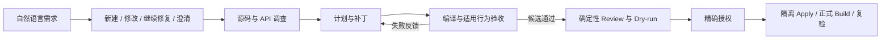

# 面向既有代码库维护的 Coding Agent 平台

**Evidence-Grounded Controlled Code Generation Agent Platform**

把自然语言需求推进到可验收的代码变更：调查当前源码与依赖 API，生成补丁，利用真实编译和行为反馈修订，再按授权应用到隔离工程。首个验证领域是 **C# / Unity / BepInEx / IL2CPP / Harmony 风格的 GTFO Mod**，同时保留面向其他代码库扩展的领域接口。

项目关注三个工程问题：Agent 是否完成了需求，修改是否在授权范围内，以及失败过程、模型成本和验收结果能否追溯。当前是研发原型，已执行真实模型、编译、受控行为验收和部分隔离交付；尚无跨项目稳定成功率、多租户或生产部署结论。

[公开实测结果](docs/PUBLIC_RESULTS.md) · [产品目标与执行边界](docs/ACTIVE_PRODUCT_CONTRACT.md) · [架构说明](docs/ARCHITECTURE_OVERVIEW.md) · [服务部署](deployment/service/README.md)

## 核心设计



| 层次 | 实现与作用 |
| --- | --- |
| 工作流与领域 | **LangGraph** 编排调查、规划、补丁、审阅、执行及恢复；领域验收器位于 `src/mod_agent/domain/`，将 C# 编译、配置检查和行为探针接入共享执行链。 |
| 源码与知识 | 默认使用 **ripgrep 活源检索**，可选索引源码；文档 RAG 通过 BM25、Dense / Hybrid、重排与引用提供证据。检索与代码修改分别拥有自己的验收口径。 |
| 受控执行 | 修改绑定目标路径、当前源码、精确 diff 和有效授权；Review、无写入 Dry-run、隔离 Apply、真实 Build 分别记录结果。支持任务委托及原人审路径。 |
| 持久化与可观测性 | **ArtifactStore** 保存业务产物、哈希和谱系；Trace 关联模型请求、工具观察、失败反馈和用量。保留候选可用于同任务复验与续接。 |
| 服务与接入 | **FastAPI + 独立 Worker + Redis** 提供异步作业、原子队列、租约、幂等、限流、缓存、超时及有界重试；提供 CLI、MCP 和只读状态入口，使用 Prometheus 与 Docker Compose 部署服务演示。 |

RAG 支撑调查，LangGraph 编排业务，ArtifactStore 保存可复查结果；外部模型与本地 Ollama 的配置、数据披露及执行授权各有明确边界。具体合同见[当前产品契约](docs/ACTIVE_PRODUCT_CONTRACT.md)。

## 已取得的结果

以下为保留原失败与分母的精选记录，完整范围见[公开结果与证据索引](docs/PUBLIC_RESULTS.md)。

| 验证对象 | 实际结果 | 适用范围 |
| --- | --- | --- |
| SpreadAPI 代码修改交付 | 非法输入原子拒绝及行为保留：原版本 **53/87** 检查通过，候选与正式 Build 后 DLL 均 **87/87** 通过；成功尝试含路由 **31,249 Token**，此前失败尝试 **42,660 Token**。 | 已暴露开发题、开发者配置的受控验收；9 个独立进程、60 个动作，跳过游戏回调主体，独立任务增量 0。 |
| 模块评测驱动修复 | 覆盖 13 个模块、224 个不同工程用例；最新结果 **222 通过、2 项训练依赖问题未解决**，修复非有限预算与 DLL / 验收身份绑定缺陷。 | 282 次执行包含复验，部分使用替身；这轮产品模型调用和新增 Mod 交付均为 0。 |
| 异步检索服务 | 两个 Worker、4 并发，**64/64** 作业成功，**1.028 作业/秒，P95 4.031 秒**。 | 6 个源码文件 / 37 个块的纯 BM25 检索，模型调用 0；该条件仅运行一次，统计窗口含收尾。 |
| 真实 Agent HTTP 入口 | 本地 Qwen3-coder:30b 经正常路由和 LangGraph 执行，候选编译成功，5 个独立进程的 **15/15 行为断言**通过，执行 **179.085 秒**。 | 终态为 `awaiting_approval`，未 Apply、未完成最终交付；不计入独立交付率。 |

服务负载继续升到 12 并发时，吞吐为 0.993 作业/秒、P95 增至 12.437 秒，瓶颈体现为排队。重复提交压测实际触发 429；缓存命中没有证明端到端提速。早期两道自有 C# 工程题的三轮候选交付为 1/6 次，尚未稳定；Self-RAG 与上下文策略实验也保留未获益或退化结果，见[历史成果清单](docs/PROJECT_OUTCOMES.md)。

## 快速开始

### 本机查看入口与运行离线检查

环境：Python 3.10+、`uv`；源码调查使用 `rg`。以下命令在仓库根目录执行，不调用模型：

```powershell
uv sync --frozen --extra dev
uv run --frozen python -m src.main --help
uv run --frozen python -m scripts.engineering_cognition --view summary --pretty
uv run --frozen pytest tests/unit/test_mod_agent_cli.py -q
```

工程导航是由当前源码生成的只读视图；CLI 检查验证入口行为。真实 Coding Agent 运行还需要目标工程、模型服务、适用的 .NET / 领域依赖，以及与目标绑定的执行 profile。

### 启动无需模型的 HTTP 检索演示

环境：Docker Engine / Docker Desktop 与 Compose。将 [`.env.example`](deployment/service/.env.example) 复制为 `deployment/service/.env`，为 `SERVICE_API_TOKEN` 和 `SERVICE_REDIS_PASSWORD` 设置两个不同的随机值；已有 `.env` 保留，不将凭据提交到 Git。为什么要有它：演示需要独立的接口及队列访问凭据，公开仓库只保存配置模板。

```powershell
docker compose --env-file deployment/service/.env -f deployment/service/compose.yaml up -d --build --scale worker=2
curl.exe http://127.0.0.1:8080/health
```

首次初始化会用仓库内真实源码建立 BM25 / Chroma 示例语料。API 文档位于 `http://127.0.0.1:8080/docs`，Prometheus 位于 `http://127.0.0.1:9095`。业务接口使用 `Authorization: Bearer <SERVICE_API_TOKEN>`；提交作业还需 `Idempotency-Key`。完整请求示例、终态查询和停止命令见[部署与接口说明](deployment/service/README.md)。

Compose 默认展示纯检索，Agent 注册表为空。完整 Agent 经同一服务模块调用现有自然语言入口；Windows / .NET 领域任务需要相应本机 profile，配置方式见[Agent 注册](deployment/service/README.md#agent-注册)。这条路径的模型预算、依赖、写入和 Build 范围都由任务配置表达。

## 代码导航

| 路径 | 内容 |
| --- | --- |
| [`src/mod_agent/`](src/mod_agent/) | Coding Agent 入口、LangGraph 工作流、ArtifactStore、证据、规划、补丁、授权、Build / Runtime / Repair 与领域验收。 |
| [`src/core/query_engine/`](src/core/query_engine/) / [`src/ingestion/`](src/ingestion/) | QueryService、检索与文档入库。 |
| [`src/service_layer/`](src/service_layer/) / [`deployment/service/`](deployment/service/) | HTTP API、Redis 存储、Worker、容器与监控配置。 |
| [`src/mcp_server/`](src/mcp_server/) / [`src/observability/`](src/observability/) | MCP 协议接入、追踪、评测及展示。 |
| [`scripts/`](scripts/) / [`tests/`](tests/) | 正常入口桥接、工程导航、评测与压测脚本，以及单元、集成和端到端检查。 |
| [`docs/`](docs/) | 产品合同、架构、公开成果、评测定义及历史研究记录。 |

进一步阅读：[CLI 实现](src/mod_agent/cli.py)、[自然语言路由](scripts/dsh_request_routing.py)、[工作流](src/mod_agent/workflow/graph.py)、[ArtifactStore](src/mod_agent/artifacts/store.py)、[评测定义](docs/EVALUATION_DRIVEN_DEVELOPMENT.md)、[压测口径](scripts/service_load/README.md)。

## AI 协作与成果边界

项目由维护者负责需求定义、架构与技术选型、验收设计，结合 AI 编码工具推进实现。开发助手对平台的代码贡献、产品模型在任务中的行为、独立评测结果分别记录；这里不主张全部代码由个人独立手写，也不把开发助手的修复计为产品自主完成。

产品执行中，模型建议和检索命中不授予写入权限；Apply 消费与当前源码和精确 diff 对应的授权，Build 成功与实际运行行为分开判定。为什么要有它：模型输出只能提出变更，最终副作用与成功结论需要可检查的授权和验收依据。

对外数字保留任务数量、重复次数、环境和失败；已暴露开发题、受控探针、游戏运行时和独立评测分别呈现。为什么要有它：单次成功或局部检查不能证明跨任务可靠性，也不能替代人工成本、生产容量或业务收益数据。

早期 Phase A 占位阶段已不代表当前实现。历史演进保留在[项目状态](docs/PROJECT_STATE.md)、[状态归档](docs/PROJECT_STATE.history-20260926.md)与[产品合同归档](docs/ACTIVE_PRODUCT_CONTRACT.history-20260926.md)中。
