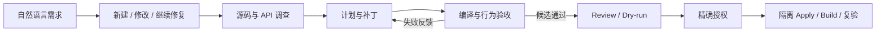

<div align="center">
  
  <p><strong>以源码证据驱动、以真实验收交付的 Coding Agent 平台</strong></p>
  <p>A coding agent platform that turns repository evidence into verified, controlled changes.</p>
  <p>
    <a href="https://github.com/yang-hoo-xin/RepoForge/actions/workflows/ci.yml"></a>
    
    
    
    
  </p>
  <p>
    <a href="#快速开始">快速开始</a> ·
    <a href="#核心模块与工程取舍">核心模块</a> ·
    <a href="docs/PUBLIC_RESULTS.md">实测结果</a> ·
    <a href="docs/ARCHITECTURE_OVERVIEW.md">架构文档</a> ·
    <a href="deployment/service/README.md">服务部署</a>
  </p>
</div>

---

RepoForge 面向新建、修改和修复代码库的自然语言任务，将**源码调查 → 补丁生成 → 编译与行为验收 → 授权交付**连接为可追溯工作流。首个验证领域是 C# / Unity / BepInEx / IL2CPP / Harmony 风格的 GTFO Mod，领域验收与共享 Agent 执行链分离，便于扩展其他工程场景。

## 核心能力

- **从当前源码找到依据**：默认使用 ripgrep 活源检索，结合依赖 API、文档 RAG 与引用，为需求调查、规划和代码修改提供上下文。
- **让验收反馈驱动修订**：LangGraph 编排任务阶段，共享 Patch worker 接入真实编译与领域行为验收；失败反馈进入后续修订，候选可保存、复验和续接。
- **让修改和结果可复查**：精确 diff、源码身份、授权和适用验收绑定；ArtifactStore 保存产物与谱系，Trace 关联模型调用、工具观察和用量。
- **把 Agent 接入服务**：FastAPI 与独立 Worker 复用正常业务入口；Redis 提供队列、租约、幂等、限流和缓存，配合超时处理、Prometheus 与 Docker Compose。

## 工作流



**LangGraph** 负责业务编排，**RAG / 活源检索**提供调查依据，**ArtifactStore**保存产物谱系，**领域验收器**连接具体工程的编译和行为检查。模型服务支持本地 Ollama 与配置的外部提供方；执行范围见[产品契约](docs/ACTIVE_PRODUCT_CONTRACT.md)。

## 核心模块与工程取舍

RepoForge 按“编排—证据—检索—生成—执行—验收—服务化”拆分职责；各模块通过显式产物与身份关联协作，领域规则与共享 Agent 控制面保持分离。

| 模块 | 职责与关键设计 | 代码 / 证据入口 |
| --- | --- | --- |
| **任务编排与状态机** | 将自然语言请求路由为新建、修改、续接或澄清任务；LangGraph 通过显式状态转移串联调查、计划、补丁、验收与失败修订，并支持 checkpoint、interrupt / resume。 | [请求路由](scripts/dsh_request_routing.py) · [工作流](src/mod_agent/workflow/graph.py) · [规划](src/mod_agent/planning/) |
| **源码证据与上下文** | 默认从当前工作区执行 `rg` 活源检索与有界源码读取，校验证据身份、freshness、需求覆盖和可编辑范围；历史记忆与文档证据只作辅助，不能替代当前源码。 | [Evidence](src/mod_agent/evidence/) · [活源检索](src/mod_agent/evidence/rg_live.py) · [上下文策略](src/mod_agent/evidence/small_project_context.py) |
| **RAG 知识检索** | 摄取链覆盖解析、切分、Embedding、BM25 与向量入库；查询层提供 Sparse / Dense / Hybrid、融合、重排和引用。Dense、RRF 与模型重排保持可选或实验定位，不冒充 Agent 默认取证路径。 | [Ingestion](src/ingestion/) · [Query Engine](src/core/query_engine/) · [检索决策](docs/RETRIEVAL_ARCHITECTURE_DECISIONS.md) |
| **补丁生成与受控执行** | Patch worker 在计划绑定的源码范围内生成最小变更；Review、Dry-run、源码 preimage、允许路径和授权共同约束副作用，再进入隔离 Apply / Build，行为失败可返回 Repair。 | [Patch loop](src/mod_agent/proposal/patch_agent_loop.py) · [受控执行](src/mod_agent/execution/) · [产品执行](src/mod_agent/product_execution.py) |
| **领域验收与评测驱动** | 共享执行链接入编译检查和领域行为裁判，保留首个失败并把可操作反馈送回修订；结果区分 `code_ready`、`awaiting_approval` 与 `delivered`，不以局部通过替代交付。 | [领域验收](src/mod_agent/domain/) · [评测](src/mod_agent/evaluation/) · [EDD 口径](docs/EVALUATION_DRIVEN_DEVELOPMENT.md) |
| **模型接入与训练实验** | 统一 LLM 抽象接入 Ollama、OpenAI、Azure 与 DeepSeek；Agent-turn 另提供 Ollama Chat、Qwen Chat 与 OpenAI Responses 适配器。QLoRA Patch SFT 与 Self-RAG 作为实验链保留，未因脚本存在而进入默认产品路径。 | [模型适配](src/libs/llm/) · [QLoRA SFT](scripts/run_patch_sft_training.py) · [Self-RAG](scripts/run_self_rag_training.py) |
| **产物谱系、追踪与恢复** | ArtifactStore 保存 revision、哈希与 lineage；Trace 关联模型请求、工具观察、Token、验收和失败反馈，支持候选保存、复验与有界续接。外部可观测投影不替代业务事实。 | [ArtifactStore](src/mod_agent/artifacts/) · [Trace](src/core/trace/) · [Observability](src/observability/) |
| **服务化与协议接入** | FastAPI、独立 Worker 与 Redis 实现异步队列、租约、幂等、限流、缓存和超时；Prometheus、Docker Compose 与 MCP 复用同一业务模块，而不是另写展示逻辑。 | [服务层](src/service_layer/) · [MCP](src/mcp_server/) · [部署指南](deployment/service/README.md) |

## 已验证成果

| 方向 | 已记录结果 | 验证范围 |
| --- | --- | --- |
| **代码修改交付** | SpreadAPI 候选与正式 DLL 均通过 **87/87** 检查，并完成精确授权的 Apply / Build。 | 已暴露开发题的受控行为验收：9 个独立进程、60 个动作；跳过游戏回调主体。 |
| **工程评测与修复** | 覆盖 **13 个模块、224 个不同工程用例**，最新结果 **222 通过**；定位并修复预算数值与验收产物身份绑定缺陷。 | 部分路径使用替身；其余 2 项训练依赖问题仍在迭代，工程用例数不等于用户任务数。 |
| **服务故障恢复** | **11 项故障联调检查通过**，覆盖 Redis 中断与恢复、Worker 死亡后的租约接管、短预算超时。 | 实际服务进程联调；执行结果不明的 Agent 任务保留为 `indeterminate`，避免盲目重跑。 |
| **异步检索性能** | 4 并发下 **64/64** 作业成功，**1.028 作业/秒，P95 4.031 秒**。 | 两个 Worker、6 个源码文件 / 37 块，单次纯 BM25 检索压测、模型调用 0；非完整 Agent 吞吐。 |

真实 Agent HTTP 入口也已接通 Qwen3-coder:30b 与 LangGraph：候选编译成功，**15/15 受控行为断言**通过，停在 `awaiting_approval`；尚未 Apply，完整交付仍在迭代。完整数据、成本、实验条件和历史结果见[公开实测记录](docs/PUBLIC_RESULTS.md)。

## 快速开始

### 本机体验

环境：Python 3.10+、`uv`；源码调查使用 `rg`。以下命令验证入口并生成只读工程导航，不调用模型：

```powershell
git clone https://github.com/yang-hoo-xin/RepoForge.git
cd RepoForge
uv sync --frozen --extra dev
uv run --frozen python -m src.main --help
uv run --frozen python -m scripts.engineering_cognition --view summary --pretty
uv run --frozen pytest tests/unit/test_mod_agent_cli.py -q
```

完整 Coding Agent 运行通过任务 profile 配置目标工程、模型服务、适用的 .NET / 领域依赖，以及写入和 Build 范围，参见[Agent 注册](deployment/service/README.md#agent-注册)。

### Docker 服务演示

环境：Docker Engine / Docker Desktop 与 Compose。将 [`.env.example`](deployment/service/.env.example) 复制为 `deployment/service/.env`，设置两个不同的随机值：`SERVICE_API_TOKEN` 和 `SERVICE_REDIS_PASSWORD`；保留已有配置，凭据不提交 Git。为什么要有它：接口和队列使用独立凭据，公开仓库只保存可共享的模板。

```powershell
docker compose --env-file deployment/service/.env -f deployment/service/compose.yaml up -d --build --scale worker=2
curl.exe http://127.0.0.1:8080/health
```

Compose 自动初始化真实仓库源码的 BM25 / Chroma 示例语料，默认运行无需模型的纯检索服务。API 文档位于 `http://127.0.0.1:8080/docs`，Prometheus 位于 `http://127.0.0.1:9095`。请求格式、认证、Agent profile 注册和停止命令见[部署指南](deployment/service/README.md)。

## 深入阅读

| 从这里开始 | 内容 |
| --- | --- |
| [公开实测结果](docs/PUBLIC_RESULTS.md) | 交付案例、服务性能、故障恢复与证据范围。 |
| [架构说明](docs/ARCHITECTURE_OVERVIEW.md) · [产品契约](docs/ACTIVE_PRODUCT_CONTRACT.md) | 模块职责、执行流程与权限边界。 |
| [部署指南](deployment/service/README.md) · [压测说明](scripts/service_load/README.md) | API / Worker / Redis / Prometheus 部署与测量口径。 |
| [测试](tests/) · [评测定义](docs/EVALUATION_DRIVEN_DEVELOPMENT.md) · [历史成果](docs/PROJECT_OUTCOMES.md) | 回归检查、评测方法与完整演进记录。 |

## 持续迭代

RepoForge 正在围绕更多独立工程任务、重复交付稳定性、训练依赖收口和服务长期运行验证持续迭代；游戏运行时与跨环境支持按具体领域任务扩展。当前发布面向本机研发与受控验证，模型质量、性能优化和成本收益以对应实验为依据，进展记录在[项目状态](docs/PROJECT_STATE.md)。

维护者负责需求定义、架构与技术选型、验收设计，并结合 AI 编码工具推进实现；平台开发、产品模型行为和独立评测分别记录。
