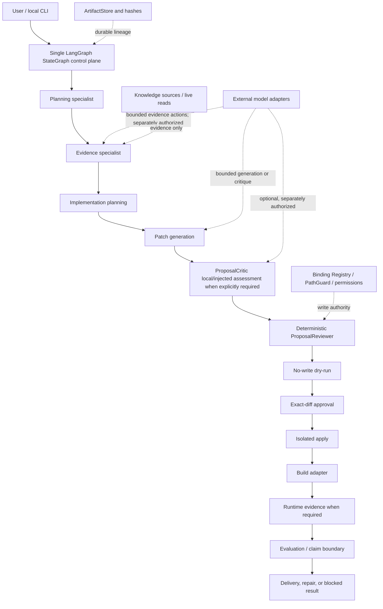
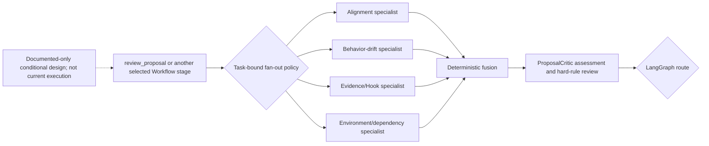
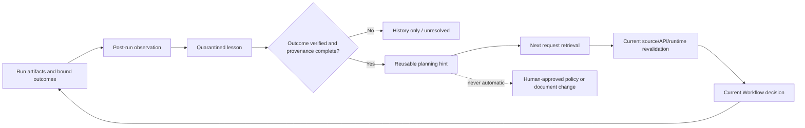

# Architecture Overview

Status: current architecture orientation

This document explains the active product shape, the verified implementation
boundary, and the rules that prevent architectural drift. It does not replace
`docs/ACTIVE_PRODUCT_CONTRACT.md`, `DEV_SPEC.md`, or the artifact contracts.

## 1. Product Boundary

This repository is an evidence-grounded controlled code-generation Agent
platform. Its first verified domain is local GTFO / BepInEx Mod development.
The product is the controlled delivery chain, not a general-purpose RAG system,
an autonomous multi-agent framework, or a benchmark platform.

```text
request
-> acceptance and verification boundary
-> current source/API evidence
-> bounded implementation bindings
-> generated proposal
-> explicitly configured ProposalCritic assessment when required
-> mandatory deterministic review
-> no-write dry-run
-> exact-diff approval
-> isolated apply
-> real build
-> required runtime/evaluation, repair, or explicit blocked result
-> truthful delivery claim
```

## 2. Current Control-Plane Architecture



LangGraph owns execution order, conditional routing, interrupt/resume, and
checkpoint integration. ArtifactStore owns durable business outputs and audit
lineage. Deterministic policies retain authority over write scope, approval,
verification, and claim promotion.

The local `plan-request` command is a bounded entry slice before this full
graph. It runs RequestPlanner and ModPlanningBriefBuilder in memory, emits both
planning payloads, and stops before `feature_spec` without ArtifactStore writes.
Hook-required planning-only requests report `needs_evidence` and hand off to
Hook discovery; this entry does not retrieve source evidence or enter proposal,
apply, build, or runtime stages.

The `evidence-request` entry uses that same graph with the explicit
`stop_after_evidence` route. It reads only the approved GTFO R8 manifest,
validates exact file hashes, symbols, and JSON identity linkage, persists the
normal planning and evidence artifacts, and maps both evidence outcomes to
`END`. It does not create a second workflow or grant implementation authority.

The bounded R8 IL inspector uses .NET `PEReader` and CLI metadata without
loading or executing the target assembly. Its exact JSON report is hash-bound
and validated before three IL EvidenceItems enter the existing evidence node.
It is a task-specific evidence reader, not a general decompiler service or a
new routing authority.

For the current WallCrawler follow-up, the same deterministic reader accepts
only an explicitly supplied assembly path and an exact symbol set selected by
the Evidence specialist. It rereads the assembly hash before and after
inspection and records current interop or reference-Mod items in the normal
EvidencePack. It is not a separate Agent and is not a RAG authority: retrieval
may later find its recorded facts, but cannot replace live hash and metadata
validation.

The current Evidence specialist also has one implemented bounded internal
loop. It is not a second graph and does not own routing:

```text
natural-language evidence goal + path-hidden registered source views
-> provider-neutral Agent turn returns one native tool call or final JSON object
-> deterministic source/tool/argument/budget validation
-> local read-only metadata observation
-> model selects an observed method_id
-> deterministic exact IL read and identity revalidation
-> model emits observation-bound findings and unresolved questions
-> deterministic EvidencePack serialization
-> LangGraph stop, continue, or blocked route
```

The long-lived source layer remains `SourceDefinition` / Source Registry. For
this loop its metadata projection uses these exact fields:

```json
{
  "evidence_discovery_kind": "unity_script_assembly",
  "evidence_class": "supplied_r8_unity_export",
  "description": "R8 Modules assembly supplied by the user.",
  "allowed_tools": ["search_dotnet_metadata", "inspect_method_il"],
  "assembly_relative_paths": ["Modules-ASM.dll"],
  "version_identity": {"game_release": "R8"}
}
```

`root_path` stays in the machine-local registry and is never included in the
model view. The single-run input is the request plus budgets and stop boundary.
The model cannot supply an absolute path or exact symbol to the IL tool; it must
use a current-run `method_id` bound to source id, relative path, assembly hash,
MVID, metadata token, and exact observed symbol. External chat execution
requires a one-run disclosure record covering the request, path-hidden source
views, and metadata/IL observations. Injected local tests require no external
disclosure and are labelled as such in EvidencePack provenance.

The implemented model boundary is not `BaseLLM.chat()` widened with
provider-specific fields. Plain chat remains intact. The adjacent structured
Agent-turn contract represents messages, exact tool JSON Schemas, tool call ids,
parsed arguments, bound tool results, final response schema, stop reason,
provider/model/request identity, and normalized token usage. Two provider wire
mappings are locally tested:

- `QwenChatAgentAdapter` uses OpenAI-compatible Chat Completions native tools,
  disables thinking and parallel calls for this dependent evidence sequence,
  and uses documented JSON-object mode for a forced final turn. Qwen's wire
  response is still subject to all local deterministic validators; no provider
  strict-schema equivalence is assumed.
- `OpenAIResponsesAgentAdapter` maps typed input/output items, exact
  `function_call` / `function_call_output` linkage, returned reasoning items,
  strict `text.format`, incomplete/status reason, and usage. It is an adapter
  inside the Evidence specialist, not a second orchestrator or durable state
  owner.

The local Artifact/trajectory remains authoritative. Provider continuation is
used only to bind the immediately preceding tool call to its output; the
platform does not treat provider-side conversation state or
`previous_response_id` as workflow memory.

Final conclusions use one exact classification: `observed`, `inferred`, or
`unknown`. The validator requires current-run observation refs for observed and
inferred claims, limitations for inferred claims, and no observation refs for
unknown claims. The durable audit projection stores sanitized action JSON and
hashes, observation hashes and byte counts, prompt-contract and initial-context
hashes, model identity, and budget consumption. It intentionally does not store
the raw prompt or expose machine-local roots.

Each turn is reconstructed rather than appended to an unbounded chat history:

```text
immutable initial goal and path-hidden source views
+ compact prior action/observation summaries and observed method ids
+ latest full observation only
+ current budget or correction state
```

Earlier full observations remain in the EvidencePack audit trace but are not
replayed cumulatively. Metadata search requires `result_kinds` and
`limit_per_kind`; its model projection factors assembly SHA256/MVID into one
assembly table and carries per-kind matched/returned/truncated counts. The
default local cap is 50 results per requested kind and 16 KiB per metadata model
observation.

For the pending real-model rerun, the ignored machine-local registry contains
two task-relevant exact sources rather than unrelated directory noise:
the supplied R8 `Modules-ASM.dll` and current installed interop
`Modules-ASM.dll`. Their registered SHA256/MVID values are checked against the
live metadata report on every search. This local registry is execution input,
not a committed cross-machine configuration or a new retrieval subsystem.

The prior approved Qwen run is retained as failure evidence: it exhausted 8
model steps and 6 tool calls after 205,912 observation bytes and produced no
conclusion. It triggered compact context reconstruction, focused metadata
results, native structured turns, and stricter trajectory acceptance. It did
not prove semantic discovery quality, and rerunning Qwen requires a new per-run
disclosure approval.

## 3. Workflow, ReAct, And Specialist Roles

The top-level product loop remains a controlled Workflow. This is deliberate:
code modification requires stable permission, evidence, review, approval,
rollback, and claim boundaries.

Specialist roles run inside the single graph. They are not independent workers
with unrestricted tools or separate write authority. A specialist may use a
bounded internal reasoning/tool loop only after a real task demonstrates that a
fixed step is insufficient. Such a loop must have an explicit evidence scope,
tool allow-list, retry budget, stopping rule, and structured output contract.

ReAct is therefore an optional local strategy, not the control plane and not an
active migration target.

### 3.1 Architecture Reference Status

Architecture references in this document use three exact maturity labels:

| Label | Meaning | Effect on implementation work |
| --- | --- | --- |
| `implemented` | Current source contains the behavior and focused evidence supports the stated boundary | May be reused within its recorded claim limits |
| `documented_only` | The design clarifies separation of responsibilities or a possible shape, but the behavior is absent from current source | Must not be claimed, invoked, configured, or treated as a missing active task |
| `conditional_trigger` | The design may enter the queue only after the named product failure or use case is recorded | The trigger authorizes a bounded decision or implementation task, not the entire reference architecture |

`documented_only` and `conditional_trigger` are not synonyms for queued,
planned, required, or partially implemented.

### 3.2 Bounded Specialist Fan-Out

The Workflow may call several same-level read-only specialists when one real
decision contains separable risk dimensions. The fraud-domain labels in the
reference diagram are not copied into this product. For controlled code
delivery, useful dimensions may include:

- requirement and acceptance alignment;
- Hook/API/source-evidence adequacy;
- behavior drift and non-goal preservation;
- environment, dependency, and compatibility risk;
- build/runtime verification adequacy;
- permission, disclosure, and supply-chain boundaries.

Only dimensions relevant to the selected request should run. Do not create an
always-on specialist swarm merely to resemble a multi-agent diagram.



Each specialist receives a bounded context pack containing registered Artifact
refs/hashes and only the evidence excerpts required for its dimension. It must
return a structured assessment with summary, findings, supporting refs,
unknowns, limitations, and a recommended action. A summary alone is not
evidence and cannot support claim promotion. Specialists do not receive file
write, apply, build, approval, route-selection, or unrestricted retrieval
authority.

The fusion policy validates freshness, required dimensions, score ranges,
missing/failed specialists, and contradictions. It may reduce confidence or
route to repair/human clarification, but only LangGraph conditional edges make
the final transition. Parallel execution, timeouts, and partial-result handling
remain unimplemented until a real task justifies them.

Current maturity: `documented_only`.

`conditional_trigger`: a selected product request must contain two or more
separable assessment dimensions whose independent results can materially change
the route, and the existing single review path must have produced or exposed a
specific insufficiency. The trigger permits only the minimum required
specialists and fusion rule.

## 4. ProposalCritic Local/Injected Assessment Boundary

The ProposalCritic local/injected assessment boundary reviews a main-role
judgment without becoming a second controller.
For the patch path, it reads the registered `patch_proposal` and its bound
upstream context, then emits a structured `critic_assessment` containing:

- the exact subject artifact ref and hash;
- dimension scores and total score;
- a pass, revise, block, or unresolved verdict;
- structured findings and limitations;
- an explicit read-only/no-route-authority boundary.

The deterministic review layer fuses this assessment with existing hard rules.
A passing ProposalCritic assessment cannot override missing evidence, an
invalid binding, a forbidden path, missing permission, or a required human
approval. A failing or unresolved ProposalCritic assessment cannot approve a
write. LangGraph conditional edges make the final continue/repair/blocked
transition.

The implemented boundary supports the local deterministic scorer or an injected
scorer. Calling a separate external model is a later adapter choice and
requires the same per-run disclosure and secret-handling rules as other model
calls. Until a real external Critic run is preserved, the project must not claim
that external-model ProposalCritic review has been validated.

This is a specialist provider hosted by
the existing `review_proposal` node. Its result is saved as a separate
`critic_assessment` Artifact, but it does not add a second routing system or an
always-on model call. A separate LangGraph node is justified only if a real use
case later requires independent retry, timeout, or latency routing.

Current maturity: `implemented` for ProposalReviewer hard-rule review plus one
optional ProposalCritic local/injected assessment inside `review_proposal`.

The following two-level review design is `documented_only`:

1. each Worker performs a lightweight structured self-check before returning;
2. same-level Worker outputs are deterministically fused;
3. a second-level ProposalCritic receives the fused judgment and complete
   evidence chain in a separate clean context;
4. the second level performs adversarial review but still has no write,
   approval, or LangGraph route authority.

The current implementation does not provide a universal Worker self-check
contract, parallel Worker scoring, a fusion result, a separate clean-context
second-level Critic, or two-level-review execution evidence.

`conditional_trigger`: a selected real task must show that the implemented
ProposalReviewer plus single ProposalCritic boundary misses a material conflict
because evidence is split across specialist contexts, or that context
isolation/retry/timeout requires a separate review node. One trigger does not
authorize a general multi-agent review platform.

### 4.1 Requirement States And Routes

There is no inferred risk trigger. The graph caller must set the requirement
explicitly.

| State | Meaning | Deterministic route |
| --- | --- | --- |
| `not_required` | `critic_requirement="not_required"`; ProposalCritic is not called and no `critic_assessment` is written | Apply existing ProposalReviewer hard rules; approval continues to dry-run, revision enters repair, other blockers enter blocked |
| `required_succeeded` | `critic_requirement="required"`; the provider returned a structurally valid, current-hash-bound assessment | Pass verdict plus score at least 80 continues through hard rules; revise/low score enters repair; block verdict enters blocked |
| `required_failed` | Required provider is absent, raises, returns unresolved, stale, malformed, wrong-policy, or wrong-hash output | Fail closed to blocked; no dry-run and no implicit retry |

Supplying a provider while the requirement is `not_required` is a configuration
error. This prevents an injected scorer from silently becoming an execution
trigger.

### 4.2 Score Aggregation Policy

Policy version: `proposal_critic_local_injected_v1`.

Applicability: `patch_proposal_review_only`. It does not score retrieval,
runtime acceptance, final task success, or cross-project quality.

Aggregation is `equal_weight_rounded_mean`: evidence grounding, scope
discipline, verification quality, and reversibility each contribute 25 percent;
the rounded arithmetic mean must be at least 80. Passing also requires verdict
`pass`, no blocking ProposalCritic finding, an exact current `patch_proposal`
hash, and a valid read-only authority declaration.

Priority is fixed:

1. ProposalReviewer hard blockers, permissions, binding rules, and human
   approval cannot be overridden by any score.
2. Required ProposalCritic execution/binding/schema failure blocks the path.
3. A valid block verdict blocks; revise or a score below 80 enters repair.
4. Only a valid pass at or above 80 may continue to the remaining hard rules.

The score is a local structural policy, not evidence that semantic correctness,
runtime behavior, or product quality improved.

### 4.3 Business Decision And Action Translation

Current maturity: `implemented` for the existing deterministic Mod-delivery
actions. ProposalReviewer and LangGraph currently translate review facts into
the exact decisions and routes already represented by the workflow, including:

- `approve_dry_run` to no-write dry-run;
- `revise_proposal` to the bounded repair path;
- `blocked_insufficient_evidence`, `blocked_scope_risk`, and
  `blocked_requires_human` to blocked handling;
- exact-diff approval before isolated apply;
- task-specific runtime/evaluation applicability through the acceptance
  boundary.

The fraud-domain four-tier action model (low risk direct release, medium risk
step-up verification, high risk rejection, and grey-zone manual handling) is
`documented_only` as a business-architecture reference. This repository does
not implement a generic configurable risk engine, merchant/amount tiers,
business-loss thresholds, or outcome-driven threshold tuning. ProposalCritic's
80-point patch-review policy is not a general business-risk score.

`conditional_trigger`: a selected product request must require an action that
the existing review/repair/blocked/runtime/evaluation routes cannot express,
and the required action must be derived from that request's real acceptance or
safety boundary. Implement the smallest deterministic action rule; do not add
a generic risk platform merely to mirror the reference model.

### 4.4 Long-Term Experience And Closed-Loop Improvement

Artifact history, checkpoint state, and chat history are not automatically
trusted long-term memory. Closed-loop improvement must preserve the distinction
between an observed run, a reusable lesson, and an approved control rule.



A reusable lesson must bind at least the original request, relevant source and
Artifact hashes, environment/version context, observed failure, action taken,
verification result, limitations, and invalidation conditions. It may help the
next run choose evidence queries, identify risks, preserve non-goals, or propose
tests. It may not authorize a path, Hook, patch, permission, runtime claim, or
delivery decision.

Current source, current API shape, current Binding Registry, current runtime
evidence, and explicit user approval always outrank stored experience. A lesson
whose source/version/environment assumptions no longer match is stale and must
be rejected or revalidated.

The system must not silently rewrite prompts, scoring thresholds, `AGENTS.md`,
SPEC documents, permissions, or routing policy from one outcome. A durable
control-rule change requires explicit human review and a normal code/document
change with tests or recorded rationale. This is governed learning, not
self-modifying behavior.

The current repository has Artifact lineage and planning placeholders for
retrieved experience, but it does not yet implement verified lesson extraction,
experience retrieval, automatic feedback ingestion, or policy learning. Those
capabilities should begin only after repeated real tasks show that manually
recorded lessons are useful and the required provenance can be captured without
building a separate memory platform.

Current maturity is split deliberately:

- `implemented`: immutable run artifacts and hashes, checkpoint/runtime state
  at their existing boundaries, Git history, and `LOOP_HISTORY` as audit
  records. These are stored evidence, not learned memory.
- `documented_only`: verified-lesson quarantine, next-request experience
  retrieval, asynchronous real-outcome feedback ingestion, automatic risk
  profile updates, Recall/Precision feedback, threshold learning, and policy
  learning.
- `conditional_trigger`: repeated verified real tasks must expose the same
  recurrence or retrieval failure, the outcomes must be provenance-bound, and
  manual lessons must be demonstrably insufficient. The first triggered task
  is a bounded lesson-capture/retrieval experiment, not an automatic policy
  updater.

## 5. Architecture Maturity

| Area | Current status | Allowed claim |
| --- | --- | --- |
| Local request entry | Verified for one BetterHitFeedback request-to-build run | Local synchronous entry works for the preserved run |
| LangGraph StateGraph and conditional routing | Tested | One controlled graph owns the implemented route matrix |
| Structured Evidence Agent turns | Qwen Chat and OpenAI Responses request/response mappings locally tested | Provider-neutral tool/final/usage semantics work inside the Evidence specialist; no real-provider semantic-quality claim |
| Artifact lineage and hash binding | Tested on focused paths | Registered outputs retain current upstream refs and hashes |
| Patch review, no-write dry-run, and exact approval | Verified on the narrow real run plus focused tests | Model output cannot directly authorize a write |
| ProposalCritic local/injected assessment boundary | Tested for explicit not-required, required-success, and required-failure paths | No external-model or semantic-quality-improvement claim |
| Two-level Critic and same-level specialist fan-out | `documented_only`; `conditional_trigger` not satisfied | No Worker self-check, parallel specialist execution, deterministic fusion, clean-context second-level Critic, or two-level-review claim |
| Business decision/action translation | Existing Mod workflow routes `implemented`; generic four-tier risk model `documented_only` | No generic business-risk engine, configurable domain thresholds, or automatic action tuning claim |
| Real build | Verified for the preserved BetterHitFeedback run | The declared DLL compiled for that run |
| Gameplay/runtime acceptance | Not verified for that run | No gameplay-success claim |
| Persistent cross-process checkpoint backend | Future/product-failure triggered | In-memory/local checkpoint behavior only |
| MCP/API/webhook/scheduler trigger surfaces | Partial or future-triggered | They are not the current production entry |
| Long-term experience and closed-loop learning | Audit storage `implemented`; learning design `documented_only`; `conditional_trigger` not satisfied | Artifact history is not automatic memory, feedback learning, or policy tuning |
| ReAct/Agentic routing | Deferred | No active architecture migration |

## 6. Change Triggers And Stop Rules

Do not add graph nodes, schemas, model roles, retrieval infrastructure,
dashboards, MCP write routes, or evaluation machinery merely to make the
architecture look complete.

An architectural change requires at least one of:

- a concrete real request cannot complete through the current chain;
- an observed failure cannot be represented or routed truthfully;
- a demonstrated safety or claim defect requires a new gate;
- a selected external user/client requires a missing interface;
- a bounded product decision requires new evidence.

After the smallest verified fix or capability succeeds, stop architecture work
and return to the product request. Workflow maturity is supporting evidence,
not an independent delivery goal.

## 7. Portfolio And Engineering Story

The project demonstrates engineering and design ability through the combination
of a runnable vertical workflow and explicit control boundaries:

- LangGraph state-machine orchestration and deterministic conditional routing;
- evidence provenance, binding identity, hashes, and stale-data checks;
- bounded model authority and read-only ProposalCritic assessment;
- human approval, isolated mutation, rollback, and reproducible build evidence;
- domain adapters separating GTFO behavior from generic platform control;
- truthful separation of tested, compiled, runtime-observed, and accepted claims;
- failure-triggered evolution instead of roadmap-driven infrastructure growth.

The strongest next breadth proof is another concrete Mod capability or delivery
shape that exercises the existing control plane and exposes a real missing
capability.

## 8. Authority Reference

This document does not define an authority or reading order. Follow
`AGENTS.md` section 2 exclusively.
