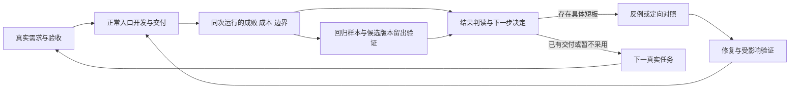

# 真实交付与评测共同推进

更新于2026-09-29。目标是理解自然语言，完成新 Mod 创建、生成中的迭代修复、已有问题 Mod／代码库修改，并用同一次真实执行检验平台能力。七类待测继续保留在[成果与证据清单](PROJECT_OUTCOMES.md)；任务选择见[实施队列](IMPLEMENTATION_QUEUE.md)，指标定义见[评测协议](EVALUATION_DRIVEN_DEVELOPMENT.md)。

## 每个交付周期

| 动作 | 同时得到的结果 | 为什么要有它 |
| --- | --- | --- |
| 选择真实需求，明确预期行为、保留行为、目标工程和适用验收 | 一项可交付修改及可执行的成败判定；验收要求能由公开需求、接口合同或允许读取的材料推出 | 为什么要有它：选题对应维护成本、回归风险或交付障碍，避免为凑指标挑题或让模型猜隐藏偏好。 |
| 沿正常入口调查、实现、验收和交付，复用现有工具与裁判 | 工程、补丁、适用Build/运行结果；已有Trace同时记录模型/工具和执行事实 | 为什么要有它：真实构建和行为检查就是这次交付的评测，不必为了记录再生成一次答案或另建runner。 |
| 从原件汇总成败、实际成本、介入和边界；判断失败或退化反映什么 | 原运行引用、直接原因及采用/修复/回退/证据不足的决定 | 为什么要有它：数据需要改变下一步；缺失成本标未知，不能为了补统计字段阻塞已满足验收的合法交付。 |
| 将有复用价值的失败变成回归，必要时做针对性对照，再回到真实任务 | 平台短板的修复、受影响验收与邻近任务验证 | 为什么要有它：回归防止重犯，任务结果检查修复有没有实际作用；只停在局部测试不算交付改善。 |

## 三种评测按用途嵌入

| 用途 | 何时做、复用什么 | 为什么要有它 |
| --- | --- | --- |
| 每次交付的验收与观察 | 正常 `run-request` 的验收、manifest/result、批准和执行回执；`measure_product_task.py` 汇总已记录的段，`product_trace.py` 查原始过程 | 为什么要有它：日常即积累可复查数据；所选段用量不自动升级为完整任务成本，人工工时等缺项仅在需要时补录。 |
| 解释具体短板的实验 | 结果会影响修复选择或投入时，固定同一失败候选/反馈或同一任务做最小对照；复用 `run_patch_sft_eval.py`、`probe_retained_requests.py` 和公共批次runner | 为什么要有它：分清模型、上下文、规格、环境和裁判问题；无新假设、输入或配置变化时收口原试验，不靠重复跑分维持进展。 |
| 检验采用与泛化 | 候选策略准备采用、或需要独立成果声明时，用预先选定的新任务和重复运行；复用 `run_product_trial_batch.py` 与已有独立任务发布/裁判 | 为什么要有它：旧任务负责开发和回归，新任务检验迁移；同题重复不能增加独立任务数。 |

比较问题决定基线：版本回归用已冻结版本；架构取舍增加合理的“读源码→修改→测试→修订”简化循环，并保留相同源码、权限、隔离、验收和授权边界；修订机制比较固定同一失败候选与反馈。现有给定Plan的Patch/Repair可先作阶段对照，完整自然语言简化基线仍需接线验证。为什么要有它：修复旧接线故障、改进修订能力和证明复杂架构净收益，是不同结论。

## Astra的开发职责与投入取舍

Astra负责调查、实现、判读和维护平台；产品运行继续按选定本地模型评测。Astra或开发者补解法、改候选代码的交付另记辅助完成；正常模型运行的结果保持原样。为什么要有它：开发助手的能力不能被记成被测产品模型的成功率。

主线程推进当前交付，独立调查、裁判核对、邻近回归或留出制备可并行；代码修改按实际所有者划分。共享本地模型/GPU和有状态执行按资源隔离安排，不为用满并行度制造竞争。为什么要有它：Ultra的并行应缩短交付等待，避免多份审计和相互影响的测量。

七类证据都保留完成责任，但每轮选择能推进当前交付或明确成果缺口的测量；训练、检索优化和追踪等专题有具体问题及退出结论时推进。当前不设固定投入比例，也不把某一道题成功设为所有后续工作的前置条件。为什么要有它：兼顾交付与完整证据目标，避免七线平铺或永久搁置待测。

## 官方依据与项目应用

2026-09-29已查阅当前官方页面：

- [Astra行为与开发建议](https://developers.openai.com/api/docs/guides/latest-model#prompting-best-practices)：强调自主推进、核查技能/文件中的冲突指令、有意义的并行，以及按改动范围验证。本项目沿用当前8条AGENTS约定，纠正活动文档中的冲突，不追加整套相同规则。
- [Codex实践](https://learn.chatgpt.com/guides/best-practices)：任务应有目标、上下文、约束和完成条件，常驻指导保持简短、具体。这里用现有任务记录表达，不要求每次另填实验表。
- [评测实践](https://developers.openai.com/api/docs/guides/evaluation-best-practices)：从实际使用和失败收集用例，按任务设计评测、持续比较并校准评分；架构复杂度由评测需要推动。本项目优先复用现有本地设施。
- [Ultra说明](https://learn.chatgpt.com/docs/models#know-when-to-use-max-or-ultra)：Ultra通过子agent处理可拆分工作。此处用于并行工程工作，不推导被测本地模型会自动获得同样能力。

以上工作安排是结合仓库作出的应用判断，不是官方规定的比例、题数或成功率标准。为什么要有它：模型使用建议需要落实到实际项目，不能再变成脱离任务的新门禁。
